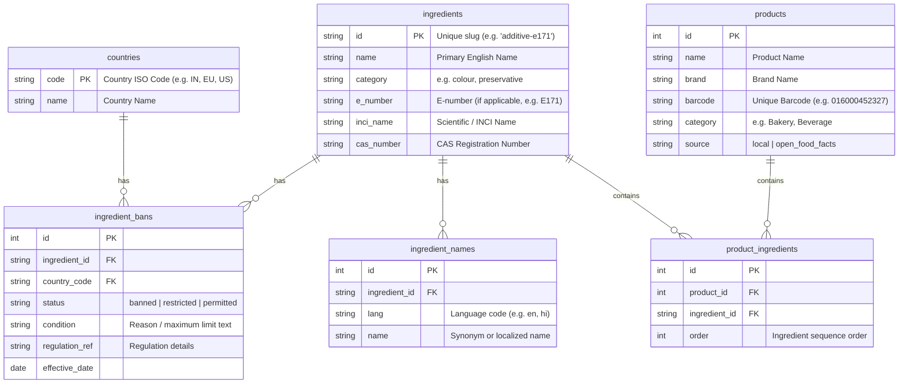

# Database Schema Reference

This document outlines the database schema and entity relationships for the FoodCheck backend service.

## Entity Relationship Diagram

## Tables & Field Definitions

### 1. `countries`
Tracks target countries or regions whose food safety regulations are monitored.
- `code` (PK): ISO country code (e.g., `"IN"`, `"EU"`, `"US"`, `"AU"`).
- `name`: Human-readable name of the country/region.

### 2. `ingredients`
The master ingredient catalog tracking names, categories, and identifiers.
- `id` (PK): Slug identifier (e.g., `"additive-e171"`).
- `name`: Standard English name.
- `category`: Classification group (e.g., `"colour"`, `"preservative"`).
- `e_number`: E-number identifier (e.g., `"E171"`), indexed for quick resolution.
- `inci_name`: Scientific or International Nomenclature Cosmetic Ingredient name.
- `cas_number`: Chemical Abstracts Service registry number.

### 3. `ingredient_names`
Robust localized synonyms mapping to a primary ingredient. Used for OCR dictionary lookups.
- `id` (PK): Auto-incremented ID.
- `ingredient_id` (FK): Links to `ingredients.id`.
- `lang`: Language code of the synonym (e.g., `"en"`, `"hi"`, `"ml"`).
- `name`: Localized name or synonym, indexed.

### 4. `ingredient_bans`
Regulatory status records mapping ingredients to countries.
- `id` (PK): Auto-incremented ID.
- `ingredient_id` (FK): Links to `ingredients.id`.
- `country_code` (FK): Links to `countries.code`.
- `status`: `"banned"` | `"restricted"` | `"permitted"`.
- `condition`: Details on maximum permissible limits or warnings.
- `regulation_ref`: Official legal reference or commission order.
- `effective_date`: Start date of enforcement.

### 5. `products`
Scanned or search-cached products.
- `id` (PK): Auto-incremented ID.
- `name`: Product title.
- `brand`: Brand identifier.
- `barcode`: EAN/UPC barcode, unique and indexed.
- `category`: Category group.
- `source`: Origin system (`"local"` or `"open_food_facts"`).

### 6. `product_ingredients`
Many-to-many join table mapping ingredients to specific products.
- `id` (PK): Auto-incremented ID.
- `product_id` (FK): Links to `products.id`.
- `ingredient_id` (FK): Links to `ingredients.id`.
- `order`: Sequence order in the product's ingredients declaration.
